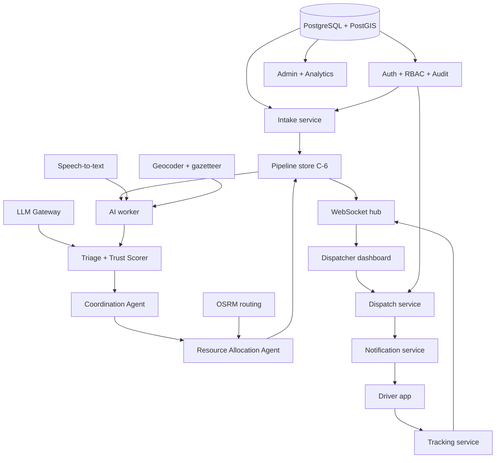

# Part 1 — SRS analysis

Source: SRS v1.1 (A-008). Every ID below (F1–F9, UC-01…UC-13, NFR-P/S/C, SW, CI, TC) exists in SRS/SDS v1.1.

## 1.1 The project in one paragraph

A prototype AI-assisted dispatch desk modelled on Rescue 1122. Reports arrive by voice, SMS/text, a public web page and an Android app; each becomes one **Incident Record** (SRS Table 3.4) saved before any AI step. Three agents understand the report (Triage, with a rule-based Trust Scorer), find duplicates (Coordination) and recommend vehicles (Resource Allocation). A human dispatcher approves every dispatch. A driver app receives the assignment, navigates, reports GPS about every 5 s and updates trip status; a live map shows the fleet. Admins manage users, vehicles, hospitals and settings; reports compare AI-assisted and manual handling. Everything uses simulated data in one pilot area; there is no connection to the real 1122 systems (SRS §1.4–1.5, NFR-C7).

## 1.2 Features F1–F9

| ID | Feature | Main use cases | Owner module |
|---|---|---|---|
| F1 | Multi-channel report intake | UC-01 | Intake service (API) |
| F2 | Report understanding (Triage Agent) | UC-02 | Triage Agent in AI worker |
| F3 | Report trustworthiness checking | UC-03, UC-07 | Trust Scorer (inside Triage step) + review queue |
| F4 | Duplicate detection (Coordination Agent) | UC-04 | Coordination Agent |
| F5 | Vehicle and route recommendation (Resource Allocation Agent) | UC-05 | Resource Allocation Agent + Routing service |
| F6 | Dispatcher review and approval | UC-06, UC-07 | Dispatch service + dashboard |
| F7 | Live vehicle tracking | UC-10 | Tracking service + live map |
| F8 | Driver mobile application | UC-08, UC-09 | Mobile app + Dispatch/Tracking service |
| F9 | Administration and performance reports | UC-11, UC-12, UC-13 | Auth, Admin, Analytics services + admin/report screens |

## 1.3 Use cases UC-01…UC-13

| UC | Name | Actors | Automatic or human | Key rule to remember |
|---|---|---|---|---|
| UC-01 | Submit emergency report | Caller | Automatic | Save, give reference number, **then** AI (NFR-P12); flood limit (5b) |
| UC-02 | Understand and triage report | Triage Agent, Dispatcher | Automatic | Confidence on every result; < 60 % → dispatcher must check |
| UC-03 | Check report trustworthiness | Triage Agent (Trust Scorer), Dispatcher | Automatic | Start 50, signals Table 7.3.1; low confidence is **not** a trust signal |
| UC-04 | Detect duplicate reports | Coordination Agent, Dispatcher | Automatic + human | ≥ 85 link, 60–84 ask, < 60 separate; no answer = separate |
| UC-05 | Recommend vehicles and routes | Resource Allocation Agent | Automatic | Never locks a vehicle; needed + 2 spare; OSRM down → approximate ETA |
| UC-06 | Review and approve dispatch | Dispatcher | Human | ≤ 3 clicks (NFR-P14); locks vehicles; logs suggested vs chosen |
| UC-07 | Handle doubtful reports | Dispatcher | Human | Real / Fake / Need more information; fake is closed and never dispatched |
| UC-08 | Receive assignment and navigate | Driver | Human + app | Accept / Cannot Go; 60 s timeout; no typing |
| UC-09 | Update trip status | Driver, app | Automatic + human | Auto on scene (100 m) and at hospital; manual picked up and available |
| UC-10 | Track fleet live | Dispatcher | Automatic | Map ≤ 5 s; 60 s no GPS = signal lost |
| UC-11 | Log in and log out | Dispatcher, Driver, Admin | Human | 5 wrong passwords → 15 min lock; 30 min idle logout; GPS only on duty |
| UC-12 | Manage users, vehicles, hospitals | Admin | Human | Range-checked settings apply to **new** incidents only |
| UC-13 | History and performance reports | Dispatcher, Admin | Human | Four measures; CSV export; AI vs manual comparison |

## 1.4 Non-functional requirements (all of them, with how each is proved)

### Performance, reliability, usability, compatibility (SRS Table 5.1)

| ID | Requirement | Target | Proved by | Plan task |
|---|---|---|---|---|
| NFR-P1 | Text report triaged and shown | ≤ 10 s | TC-38, 50 reports, p95 | B8-01 |
| NFR-P2 | 60-s voice report transcribed and triaged | ≤ 20 s | TC-39, 20 clips | B8-02 |
| NFR-P3 | Recommendation after triage | ≤ 5 s | TC-40 | B8-03 |
| NFR-P4 | Vehicle position on live map | ≤ 5 s | TC-41 | B8-04 |
| NFR-P5 | Assignment on driver app | ≤ 5 s with network | TC-42 | B8-04 |
| NFR-P6 | Capacity | 50 reports and 100 simulated vehicles at once | TC-43 | B8-05 |
| NFR-P7 | Incident type correct | ≥ 85 % on test set | `run_eval.py` on labelled set | B1-A2-17, B8-06 |
| NFR-P8 | Severity correct | ≥ 80 % | same | B8-06 |
| NFR-P9 | Duplicates found / wrong merges | ≥ 80 % found, ≤ 5 % wrong | duplicate groups set | B8-07 |
| NFR-P10 | ETA error in simulation | ≤ 20 % | simulator vs OSRM prediction | B8-08 |
| NFR-P11 | Availability in test/demo hours | ≥ 99 % | `/health` uptime log | B8-12 |
| NFR-P12 | Report saved before processing | no loss | TC-44 | B1-A1-16, B2-06 |
| NFR-P13 | Manual mode if AI or routing stops | always | TC-45 | B6-02 |
| NFR-P14 | Clicks to approve | ≤ 3 | TC-51 | B1-A3-08 |
| NFR-P15 | Driver app needs no typing in a trip | large buttons, voice | device checklist | B1-A3-16/17 |
| NFR-P16 | Small screens, English and Urdu, Sindhi as free text | — | UI tests | B1-A3-02/03 |
| NFR-P17 | Chrome, Edge, Firefox; Android 9+ | all | TC-52 | B8-10 |
| NFR-P18 | Modules, documented API, Docker start | all | review + install on clean machine | B7-01, B1-A1-04 |

### Safety (SRS Table 5.2)

| ID | Rule | Enforced where (design) | Proved by |
|---|---|---|---|
| NFR-S1 | Human decides | Only `DispatchService.approve` creates assignments; requires dispatcher token; agents have no write access to vehicles/assignments | TC-46, B6-03 |
| NFR-S2 | Honest uncertainty | Schemas require confidence; UI components `ConfidenceMeter`, `TrustBadge` mandatory | UI tests, review |
| NFR-S3 | Urgent never waits | `policy.decide_action` never returns `review_queue` for high/critical; allocation runs for urgent | policy truth table, TC-10, B6-04 |
| NFR-S4 | Careful merging | Auto-link ≥ 85 only; link never changes incident status; reversible | TC-13/14/15, B6-05 |
| NFR-S5 | Fail-safe | `/health` + `system.service_status`; manual dispatch path; saved report survives worker death | TC-44, TC-45 |
| NFR-S6 | No double dispatch | Partial unique index on open assignments + row locks | TC-22, 50-run concurrency test |
| NFR-S7 | Prototype notice | Constant text on report page and app | TC-47 |
| NFR-S8 | Driver safety | Large buttons, voice guidance, no typing | device checklist |
| NFR-S9 | Full record | `AuditService.record` inside every state-changing transaction | B5-04 audit completeness script |
| NFR-S10 | NG911-style structure | Incident Record has time, location, type, source | schema tests |

### Security (SRS Table 5.3)

| ID | Rule | Design | Proved by |
|---|---|---|---|
| NFR-C1 | Personal accounts, salted hashes | bcrypt | auth tests |
| NFR-C2 | Role separation | `require_roles` + RBAC matrix test over every route | TC-48 |
| NFR-C3 | HTTPS | nginx TLS, HTTP→HTTPS | TC-49 |
| NFR-C4 | 30-min idle, 15-min lock after 5 failures | `user_sessions`, `locked_until` | TC-32 |
| NFR-C5 | Location privacy | Driver GPS only on duty; caller phone/location to staff only | TC-33 |
| NFR-C6 | Collect only what is needed | Public schema has description, location, optional phone/name | schema test |
| NFR-C7 | Simulated data only | seed + simulators labelled SIMULATED | review |
| NFR-C8 | Abuse protection | DB-based rate limiter | TC-05 |
| NFR-C9 | Safe code | Pydantic validation, parameterised SQL, env secrets | TC-50, secret scan |
| NFR-C10 | Encrypted backups, uneditable audit | DB trigger blocks UPDATE/DELETE on `audit_logs` | trigger test |
| NFR-C11 | Data keeping | erase script | B7-06 |

### Interfaces (SRS §2.3–2.4)

HW-1…HW-5 (server 16 GB / 8 cores; dispatcher PC; driver Android phone ≥ 5″; citizen device; microphone). SW-1…SW-11 (FastAPI, Whisper, LLM + LangGraph + Gateway, PostgreSQL 15 + PostGIS, OSRM, geocoder, Leaflet/MapLibre, React, React Native, FCM, SMS gateway/simulator). CI-1…CI-7 (HTTPS REST, WebSocket, FCM, SMS, voice audio WAV/MP3/M4A ≤ 2 min, OSRM/geocoder not public, weak-network buffering).

## 1.5 Mandatory, optional and future

| Class | Items |
|---|---|
| **Mandatory** (SRS "must", all F1–F9, all NFR-S) | everything in 1.2–1.4 except the rows below |
| **Mandatory with a stated fallback** | FCM push (CI-3): WebSocket primary, FCM when a Firebase project exists (D-013), SMS backup (UC-06 4b); Nominatim (SW-6): gazetteer first, Nominatim fallback (D-009) |
| **Optional improvements** (P2 in the plan) | PDF export of reports (CSV is mandatory), channel-simulator page, self-hosted map tiles, dedicated stations table (D-026) |
| **Future enhancements** (SRS §1.5, out of scope) | real 1122 integration, real call data, image/video/social/sensor reports, automatic dispatch, tracking hardware, voice-stress or lie detection, hospital beds/records, iOS |

## 1.6 Module dependencies

**Reading it:** nothing downstream of the "Pipeline store" can work until the database schema, auth and intake exist; the driver app cannot be finished before the dispatch service; the AI agents can be built early because they only need contracts and fakes.

## 1.7 Technical risks and unclear requirements (found while reading)

| ID | Finding | Why it matters | Proposed handling | Status |
|---|---|---|---|---|
| U-1 | **Duplicate formula proposed in D-007 cannot satisfy TC-13.** With linear decay, a report 100 m and 5 min away with a *perfect* text match scores 80 < 85 (`test_finding_linear_decay_can_never_auto_link_tc13`). | TC-13 and NFR-P9 would fail by design | Use quadratic decay (`(d/300)²`, `(Δt/15 min)²`): the same case scores 93; tune with evaluation data | New decision **D-033** |
| U-2 | Vehicle rule for "Other" says "1 vehicle chosen by the dispatcher", but the list rule says "needed + 2 spare" | UI behaviour undefined | Show all available vehicles nearest-first, no automatic type (D-019) | OPEN (D-019) |
| U-3 | "Unknown victims → recommend 1 vehicle" conflicts with fire, which already needs a truck + ambulance + backup | Under- or over-recommending | Unknown count = 1 vehicle **per required type**, plus a check flag | OPEN — extends D-019 |
| U-4 | "Plus 2 spare" for incidents with several vehicle types: 2 spares total or per type? | List length, UI | 2 spares in total, best remaining vehicles of the needed types | OPEN — extends D-019 |
| U-5 | UC-07 says a Real decision "goes on to UC-05", but UC-05 post-conditions do not say whether allocation ran earlier for low-trust reports | Extra latency vs wasted work | Skip allocation for low tier + low/medium severity until marked Real; urgent always allocated (D-021) | OPEN (D-021) |
| U-6 | NFR-P1 (10 s) depends on LLM latency; hosted models can rate-limit, local models on CPU can be slow | Core target at risk | Timeout 8 s → manual mode; two providers + FakeLLM; measure in Month 2 | R1 |
| U-7 | The SRS gives no formula for duplicate similarity and no definition of "independent report" | Cannot test without it | "Independent" = different caller or device (D-012); formula D-007/D-033 | OPEN |
| U-8 | NFR-S2 says every report shows a trust tier, but if Triage fails the trust inputs "real details / vague" are missing | A failed report would show no tier | Run the Trust Scorer on its non-LLM signals in the failure path and show tier with "AI unavailable" | New decision **D-035** |
| U-9 | Master prompt Part 4 lists tables (roles and permissions, drivers, trust scores, AI processing results, dispatcher decisions, incident status history) that the approved SDS stores differently | Two designs would cause rework | Map them to SDS tables (see `04_DATABASE.md` §4.2); add nothing until approved | New decision **D-031** |
| U-10 | SRS NFR targets still need supervisor confirmation (SRS §2.6) | Targets could change | Keep targets as settings in the evaluation harness | OPEN (D-017) |
| U-11 | Voice transcription for Sindhi is expected to be weaker than Urdu/English | NFR-P8 on Sindhi | Text channel remains backup; report accuracy per language honestly | R2 |
| U-12 | SRS lists FCM as a dependency, but FCM needs a Firebase project and credentials the team may not have | Alert path | WebSocket primary, SMS simulator backup (D-013) | OPEN |

## 1.8 Traceability matrix (feature → everything it touches)

| Feature | UC | NFR | SDS tables / sections | API groups (SDS Table 4.3) | Screens | TC | Plan tasks |
|---|---|---|---|---|---|---|---|
| **F1** Intake | UC-01 | P12, P16, S7, C6, C8, C9 | §3.1, Tables 5.1, 5.2 | `/reports`, `/reports/voice`, `/intake/*` | Public report page, citizen app | 01–05, 44, 47, 50 | B1-A1-16/17/18, B1-A3-03/14, B4-01/02 |
| **F2** Triage | UC-02 | P1, P2, P7, P8, S2 | §4.2, Table 6.3 | (internal) `GET /incidents/{id}` | Incident review | 06–08, 38, 39 | B1-A2-01/02/03/04/05, B1-A2-17 |
| **F3** Trust | UC-03, UC-07 | S2, S3, C8 | Table 7.3.1/2 (SRS), Table 5.2 `trust_*` | `/review-queue`, `/incidents/{id}/review-decision`, `/confirmation-requests` | Review queue | 09–12, 24, 25 | B1-A2-06/07, B1-A1-23/24, B1-A3-09 |
| **F4** Duplicates | UC-04 | S4, P9 | Tables 5.3, 5.12 | `/duplicate-candidates/*` | Incident review (warning) | 13–15 | B1-A2-08/09, B1-A1-22 |
| **F5** Allocation | UC-05 | P3, P10, S5, S6 | Tables 5.7, 6.3 | `/routing/route`, `/vehicles` | Dispatch approval panel | 16–20, 40 | B1-A2-10/11/12/15 |
| **F6** Dispatch | UC-06, UC-07 | S1, S3, S6, S9, P14 | Tables 5.8, 5.10 | `/incidents`, `/incidents/{id}/dispatch` | Queue, review, approval | 21–25, 46, 51 | B1-A1-20/21/25, B1-A3-06/07/08 |
| **F7** Tracking | UC-10 | P4, P6, C5 | Table 5.6 | `/fleet/live`, WS events | Live map | 30, 31, 41, 43 | B1-A1-27/28/29, B1-A3-10 |
| **F8** Driver app | UC-08, UC-09, UC-11 | P5, P15, S8, C5 | Table 5.8 | `/driver/*` | Driver mode | 26–29, 33, 42 | B1-A1-26/27/30, B1-A3-13…18 |
| **F9** Admin/reports | UC-11, 12, 13 | C1–C4, C10, C11, P11 | Tables 5.4, 5.5, 5.9–5.11 | `/auth/*`, `/admin/*`, `/analytics/*` | Login, admin, reports | 32, 34–37, 48 | B1-A1-14/15/31/32, B1-A3-04/11/12 |
| Cross-cutting | — | P12, P13, P18, S5 | §4.3, §4.5 | `/health` | Service banner | 44, 45 | B1-A2-13/14, B1-A1-19/29/33, B7-01 |

Task IDs are those of `planning/IMPLEMENTATION_PLAN.md` v0.2; they were checked to exist there.
