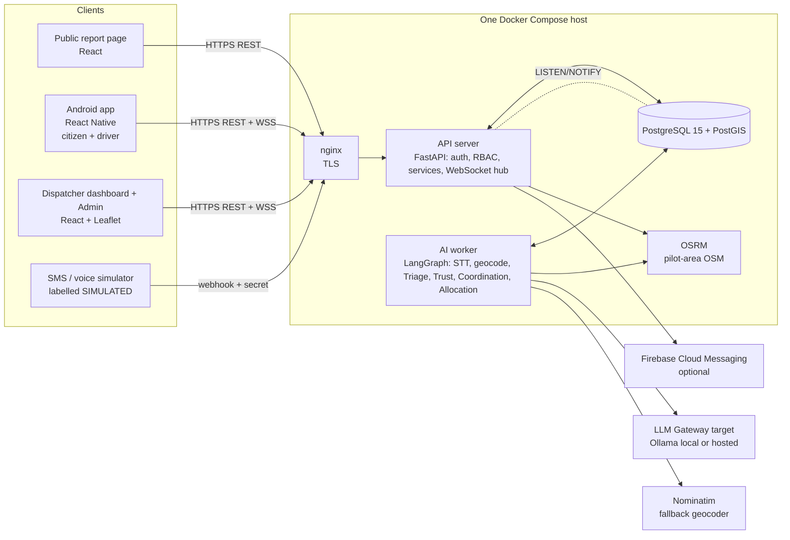
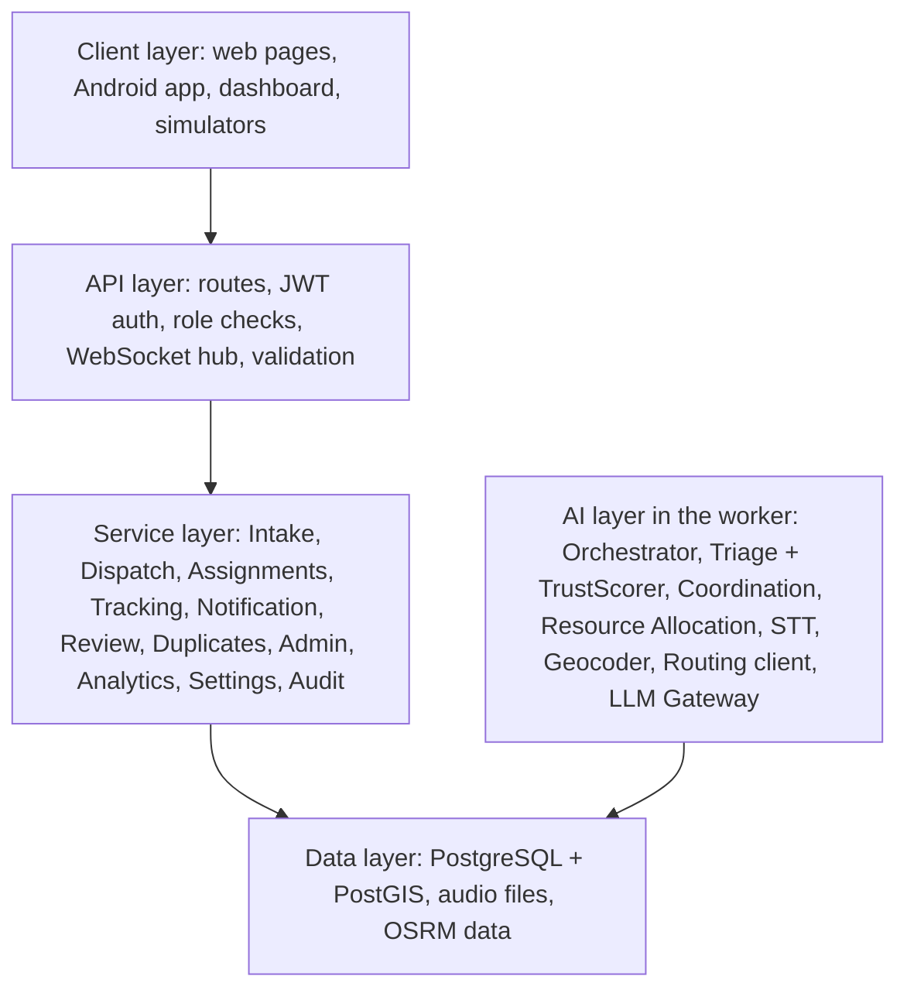
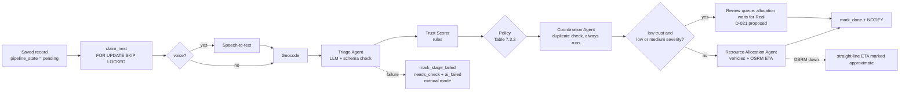
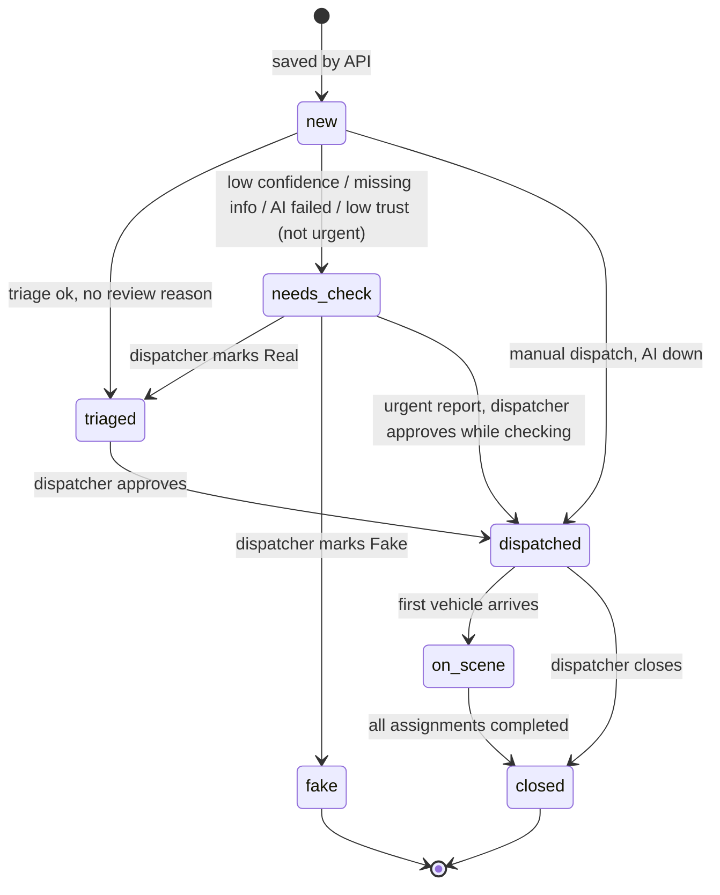
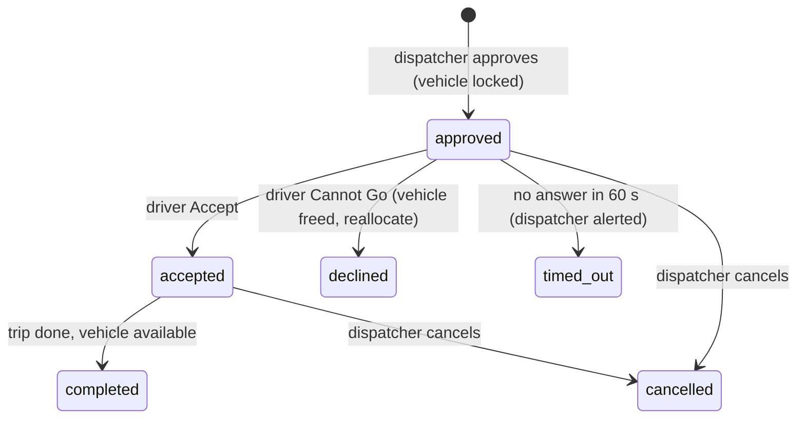

# Part 2 — System architecture

Follows SDS v1.1 §4: a **layered modular monolith** (one FastAPI application) plus **one separate AI worker process** built from the same code. It is not a microservice system (A-001) and must not become one without approval.

## 2.1 The system in one picture

Rules visible in the picture: clients never talk to the worker, OSRM, the LLM or the database directly (CI-6); the worker and the API never call each other — they meet in the database (D-010).

## 2.2 Layers

| Rule | Why |
|---|---|
| Routes contain no business logic; they call a service | Testable, replaceable |
| Services own database transactions and write the audit row in the same transaction | NFR-S9: no audit = no commit |
| The AI layer reads and writes **only** through `pipeline_store` (contract C-6) | The AI cannot touch vehicles or assignments (NFR-S1, NFR-S6) |
| Each business rule has one home: trust in `agents/trust.py`, vehicle counts in `agents/resource.py`, locking in `services/dispatch.py` | No duplicated rules, no drift |

## 2.3 How the three agents interact

They never call each other. The **orchestrator** runs them in order and passes typed state; every stage saves its result before the next stage starts.

Hand-off data between stages is the contract C-2 (`TriageResult` → `TrustAssessment` → `DuplicateCandidateResult[]` → `AllocationResult`). Details: `06_AI_AGENTS.md`.

## 2.4 Incident processing workflow (what happens, in order)

1. **Client submits** (web, app, SMS simulator, voice simulator).
2. **API saves** the Incident Record (`status=new`, `pipeline_state=pending`), writes the audit row, commits, **then** returns the reference number (`INC-000123`). No AI call happens in this request (D-011, NFR-P12).
3. Postgres `NOTIFY report_pending`; the worker claims the record. If the worker is down, the record simply waits.
4. Worker runs the stages (2.3); each stage is saved and followed by `NOTIFY incident_events`.
5. API's NOTIFY listener re-reads the row and pushes a WebSocket event (`incident.updated`, `recommendation.ready`…) to dispatchers.
6. Dispatcher reviews, may edit (→ `reallocate` job), confirms/rejects duplicates, marks doubtful reports Real/Fake.
7. Dispatcher **approves**: one transaction locks incident + vehicles, inserts assignments, audits suggested vs chosen vehicles.
8. Notification service alerts the driver (WebSocket / FCM / SMS backup).
9. Driver accepts, navigates, shares GPS (~5 s) while on duty; trip statuses move the assignment and vehicle through their state machines.
10. Last assignment completed → incident `closed`; vehicles `available` again.

## 2.5 State machines

`pipeline_state` (worker side, separate from `status`): `pending → processing → done | failed`, and `reallocate` / `retrust` jobs re-enter `processing`.

Vehicle status: `available → assigned → en_route → on_scene → transporting → at_hospital → available`, plus `offline` (off duty). Trip timestamps (`accepted_at`, `on_scene_at`, `picked_up_at`, `at_hospital_at`, `completed_at`) are stored on the assignment.

## 2.6 Synchronous and asynchronous operations

| Operation | Mode | Why |
|---|---|---|
| Report save + reference number | **Synchronous**, in the request, one transaction | The caller must not get a number for an unsaved report |
| Speech-to-text, geocoding, LLM, agents | **Asynchronous** in the AI worker | Slow and may fail; must not block intake |
| Worker → dashboard updates | **Asynchronous**: NOTIFY → WebSocket | Dashboard updates without reload; REST is the truth after reconnect |
| Dispatch approval | **Synchronous**, one DB transaction with row locks | Must be atomic to prevent double dispatch |
| Driver alert | Asynchronous after commit; failure never undoes the dispatch | Dispatch is valid even if the phone is offline; dispatcher is alerted |
| Driver GPS | Asynchronous batches (1–500 points) | Survives short network drops (CI-7) |
| Timers: 60 s timeout, 60 s signal lost | Background loop in the API (D-029) | Needs a clock, restart-safe via DB timestamps |
| Analytics queries | Synchronous read | Read-only SQL |

## 2.7 Deployment shape (SDS §4.5)

`docker compose up` starts: `nginx` (TLS) → `api`; `ai-worker` (same image, command `python -m app.workers.ai_worker`); `postgres` (postgis 15); `osrm` (pilot-area data prepared once by `infra/osrm/prepare.sh`); optional `ollama`. Today `docker-compose.yml` has only `postgres` and `api`; the rest are added in Batch 2 and Batch 7 by change request.

## 2.8 Why this architecture meets the hard targets

| Target | How the design helps | Residual risk |
|---|---|---|
| NFR-P12 no report lost | Save-first, worker crash-safe via DB state, stuck-job reset | DB itself down → 503, no reference given (honest) |
| NFR-P1 10 s | Instant NOTIFY pick-up, one LLM call per report, one OSRM `table` call per allocation | LLM latency (R1) |
| NFR-S6 no double dispatch | DB partial unique index, not just application code | none by design |
| NFR-P13 manual mode | Dispatcher screens work from REST data without AI fields | Needs UI work (B1-A3-08 manual list) |
| NFR-P18 maintainable | Folders map to modules; contracts versioned | Discipline |
