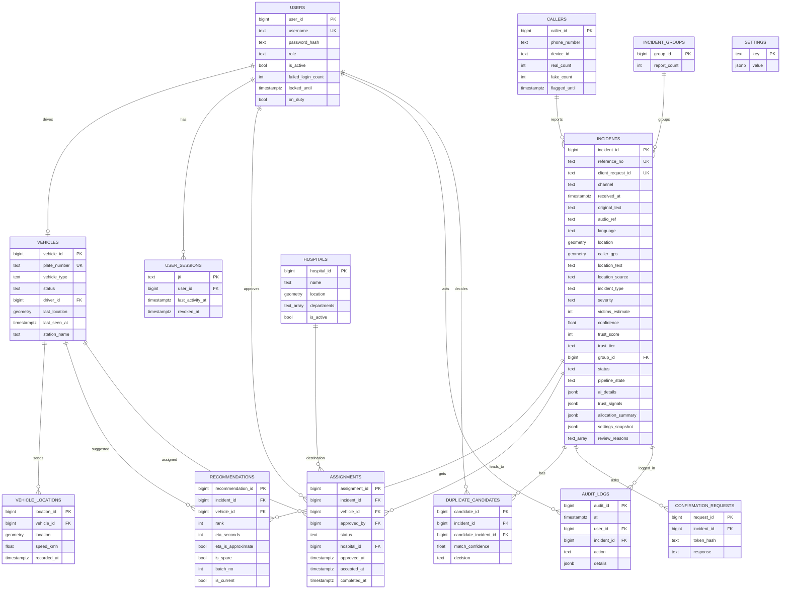

# Part 4 — Database design (PostgreSQL 15 + PostGIS)

Authority: **SDS v1.1 §5** (Tables 5.1–5.15) with the additions approved in D-004 and the vocabularies approved in D-005. This file explains the design and how to build it; it does not add tables. Where your master prompt lists tables that SDS stores differently, see §4.2.

## 4.1 Entity-relationship diagram

`settings` and `worker_heartbeats` have no foreign keys and are omitted from the relationship lines. Column lists above show the important columns only; the full lists are SDS Tables 5.1–5.15 and `planning/IMPLEMENTATION_PLAN.md` B1-A1-07…11.

## 4.2 Your prompt's table list mapped to the approved SDS design (decision D-031)

| Prompt asked for | Where it lives in SDS v1.1 | Separate table needed? |
|---|---|---|
| Users | `users` | no |
| Roles and permissions | `users.role` (CHECK: dispatcher, driver, admin); permissions are a role→route matrix in code (`api/deps.py`) with a matrix test | **No** — a permissions table would add admin screens and no new capability for 3 roles |
| Citizens / reporters | `callers` (phone, device, `real_count`, `fake_count`) + optional `incidents.reporter_name` | no |
| Incidents + incident reports | `incidents` (one record per report; the SRS Incident Record) | no |
| Duplicate groups | `incident_groups` + `incidents.group_id` + `duplicate_candidates` | no |
| Vehicles, drivers | `vehicles` (+ `driver_id` → `users`); a driver is a user with role `driver` | no |
| Hospitals | `hospitals` | no |
| Assignments | `assignments` | no |
| GPS tracking history | `vehicle_locations` | no |
| AI processing results | `incidents.ai_details` (JSONB), type/severity/victims/confidence columns, `recommendations`, `incidents.allocation_summary` | no (D-004 option (a): no separate ai_results table) |
| Trust scores | `incidents.trust_score`, `trust_tier`, `trust_signals` (JSONB reasons) | no |
| Dispatcher decisions | `assignments` (approved_by/at) + `audit_logs.details` (AI suggestion vs chosen) + `duplicate_candidates.decided_by` + review decisions in audit | no |
| Incident status history | **Not a table in SDS.** Every status change is an `audit_logs` row (`action='incident.status'` with from/to). History = a query on the audit log | **Proposed: no** (open as D-031: team confirms or asks for a table) |
| Audit logs | `audit_logs` (uneditable) | no |
| System settings | `settings` | no |

**Why not more tables:** D-004 already chose "add columns and two small tables, keep the review queue a query". More tables mean more migrations, more joins and more places for the AI result to be stored twice.

## 4.3 Core table notes (columns beyond the diagram)

| Table | Important points |
|---|---|
| `incidents` | `reference_no` = `INC-` + 6-digit id, set in the same transaction. `original_text` and `audio_ref` are never updated after insert (DB trigger; the worker may set `original_text` **once** from an empty value for voice transcripts). `location` is the resolved point; `caller_gps` is kept separately for the trust check. CHECK constraints: status, type, severity, tier, `confidence` 0–1, `trust_score` 0–100. |
| `callers` | Unique partial indexes on `phone_number` and `device_id` when not null; `flagged_until` set by the rate limiter. |
| `vehicles` | `status` ∈ available, assigned, en_route, on_scene, transporting, at_hospital, offline. `driver_id` unique when not null. |
| `assignments` | `approved_by` NOT NULL. **Partial unique index** `uq_assignment_open_vehicle` on `(vehicle_id) WHERE status IN ('approved','accepted')` — the database refuses a second open assignment. |
| `recommendations` | Separate from assignments on purpose: recommending never locks. `batch_no`/`is_current` keep old batches for audit after a re-run. |
| `audit_logs` | `details` JSONB (so "AI suggested vs dispatcher chose" is queryable). Trigger rejects UPDATE and DELETE. |
| `settings` | Key → JSONB value; every key has default, type, min, max in the settings service; a snapshot is stored on each new incident. |

## 4.4 Types and geography

- Points: `geometry(Point, 4326)` (WGS 84). Distance and radius queries cast to `geography` (`ST_DWithin(location::geography, :pt::geography, :metres)`) so metres are real metres.
- Time: all `timestamptz`, stored UTC; the UI converts to Asia/Karachi.
- Status/enum values: text with CHECK constraints (D-005), not native enums — easier to migrate.
- Money/PII: none stored beyond optional name/phone of simulated callers (NFR-C6, C7).

## 4.5 Indexing strategy

| Index | Purpose |
|---|---|
| GiST on `incidents.location`, `hospitals.location`, `vehicles.last_location` | radius and nearest-vehicle queries (duplicate candidates, allocation) |
| btree `incidents (status, severity)` | dispatcher queue |
| btree `incidents (incident_type, received_at)` | duplicate candidate query and reports |
| partial btree `incidents (pipeline_state, received_at) WHERE pipeline_state IN ('pending','reallocate')` | worker `claim_next` |
| btree `vehicle_locations (vehicle_id, recorded_at DESC)` | latest position and history |
| unique `incidents (reference_no)`, `incidents (client_request_id)` | caller lookup, idempotency (TC-04) |
| partial unique `assignments (vehicle_id) WHERE status IN ('approved','accepted')` | NFR-S6 |
| btree `audit_logs (incident_id, at)`, `(user_id, at)` | history views |
| btree `recommendations (incident_id) WHERE is_current` | current recommendations |

Rule: every index is added **with the query that needs it**, and `EXPLAIN` output for the spatial ones is pasted into CHANGES.md (task B1-A1-09).

## 4.6 Migration plan (Alembic)

| Revision | Content | Task |
|---|---|---|
| `0001_enable_postgis` | `CREATE EXTENSION postgis` | B1-A1-06 |
| `0002_initial_schema` | all tables, CHECKs, indexes, audit trigger, original-text trigger | B1-A1-11 |
| `0003_seed_settings` | default settings rows | B1-A1-12 |
| `0004+` | extra columns added with the feature that needs them (D-004 staged: Milestone-1 columns first) | per task |

Rules: one migration per task; each tested with `upgrade head` then `downgrade base` on the test database; never edit an applied migration; no schema change without approval (project rule).

## 4.7 Data used for development

| Data | Where | Size | Notes |
|---|---|---|---|
| Users, vehicles (30 → 100), hospitals (8), stations as text | `db/seed/` | small / full modes | All labelled SIMULATED; passwords from env |
| Gazetteer landmarks | `infra/gazetteer/landmarks.csv` | 50–100 | EN/Urdu/Roman-Urdu aliases |
| Labelled reports | `db/eval_data/reports.jsonl` | ≥ 200 | EN, Urdu script, Roman-Urdu, Sindhi |
| Duplicate groups | `db/eval_data/duplicate_groups.jsonl` | ≥ 50 groups incl. near-miss non-duplicates | Needed to tune D-033 |
| Voice clips | `db/eval_data/voice/` | team-recorded | Not committed if large |
