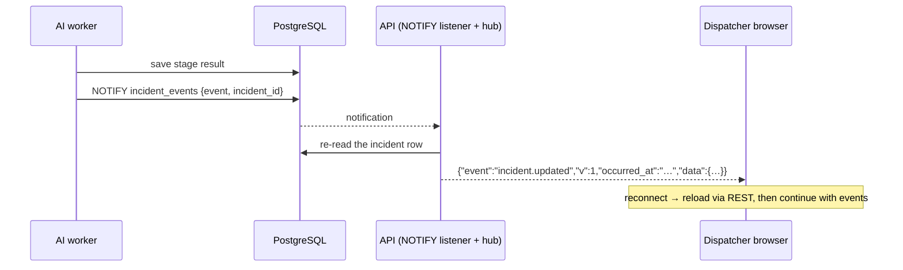

# Part 5 — Backend development plan

Authority for endpoints and events: **SDS v1.1 §4.6, Tables 4.3 and 4.4** (approved under D-006). This file adds request/response shapes, structure and rules. The field-by-field contract is written in task **B1-A1-04** as `docs/API_CONTRACT.md`; until then this file is the working draft and an endpoint that does not exist yet returns **501**, never invented data.

## 5.1 Folder structure (real today → what we add)

```
backend/
  app/
    main.py                 exists  → add /api/v1 prefix, lifespan (scheduler, NOTIFY listener)
    core/   config.py db.py exists  → add security.py (bcrypt, JWT), logging.py
    api/
      deps.py               new  get_current_user, require_roles, driver ownership check
      routes/ health.py reports.py exist → add auth, incidents, review, duplicates, dispatch,
                                           driver, fleet, hospitals, routing, admin, analytics,
                                           intake_sim, confirmation, ws
    schemas/ report.py      exists → add enums, incident, auth, events, assignment, admin  (ai.py is Agent 2's)
    models/                 empty (README.py only) → user, caller, incident, fleet, dispatch, audit, settings, review
    services/               empty → intake, audio_store, rate_limit, settings, audit, auth, incidents, duplicates,
                                    review, confirmation, dispatch, assignments, tracking, scheduler,
                                    notification, admin, analytics, pipeline_store
    ws/ hub.py              docstring → ConnectionManager, notify_listener.py
    agents/ llm/ workers/ integrations/   Agent 2 (see 06)
  migrations/               .gitkeep only → alembic env + versions
  tests/ unit/ api/ integration/ fixtures/contracts/
db/seed  db/sql  db/simulators  db/eval_data
```

Ownership by agent/person is in `planning/AGENT_RULES.md` and D-027b/D-034.

## 5.2 Conventions

| Topic | Rule |
|---|---|
| Prefix | `/api/v1` for everything except `GET /health` |
| Format | JSON; timestamps ISO-8601 UTC; ids are integers; `confidence` 0–1 in API (UI shows %) |
| Errors | `{ "code": "vehicle_locked", "message": "...", "details": {...} }` with 400, 401, 403, 404, 409, 422, 429, 503 |
| Idempotency | `client_request_id` on report creation (TC-04) |
| Pagination | `?limit=50&cursor=…` on lists; incident queue sorted by severity rank then `received_at` |
| No fake data | unimplemented routes return 501 with `code: "not_implemented"` |

## 5.3 Endpoint specification (request → response)

Roles: **P** public, **D** dispatcher, **R** driver, **A** admin, **S** simulator secret.

### Intake (UC-01)

| Endpoint | Request | Success | Errors |
|---|---|---|---|
| `POST /reports` (P) | `{ description, channel: "web"\|"app", latitude?, longitude?, location_text?, phone?, name?, client_request_id }` — description 1–2000 chars; text stored verbatim (Urdu/Sindhi fine) | `201 { reference_no: "INC-000123", status: "new", received_at }` — returned **only after commit** | 422 validation, 429 flood (message points to 1122), 503 if not saved |
| `POST /reports/voice` (P) | multipart: audio (WAV/MP3/M4A ≤ 2 min) + same fields | `201` as above | 422 type/size/duration |
| `POST /reports/{reference_no}/confirmation` (P, token) | `{ token, answer: "confirmed"\|"denied" }` | `200` | 404 bad token |
| `POST /intake/sms`, `/intake/voice` (S) | simulator payloads | `201` | 401 wrong secret |

### Auth (UC-11)

| Endpoint | Request | Success | Notes |
|---|---|---|---|
| `POST /auth/login` | `{ username, password }` | `{ access_token, expires_in, user: {id, name, role} }` | Same message for unknown user and wrong password; 5 failures → 423/403 locked 15 min |
| `POST /auth/refresh` | refresh credential | new token | Rejected if idle > 30 min (driver with open assignment exempt, D-023) |
| `POST /auth/logout` | — | `204` | Revokes the session |
| `GET /auth/me` | — | user + role | |

### Incidents and review (UC-06, UC-07, UC-04)

| Endpoint | Request | Response |
|---|---|---|
| `GET /incidents?status=&severity=&type=` (D) | filters | list of summaries: id, reference_no, severity, type, location text, received_at, trust_tier, flags |
| `GET /incidents/{id}` (D) | — | full record: original text/transcript, AI details with per-field confidence, trust score/tier/signals, review reasons, duplicate candidates, group info, current recommendations (batch), assignments, flags (`low_confidence`, `transcript_unclear`, `location_unknown`, `ai_failed`, `eta_approximate`, `vehicle_shortage`) |
| `PATCH /incidents/{id}` (D) | any of type, severity, victims_estimate, location | updated record; old recommendations marked not current; job `reallocate` queued; audit has before/after; fake/closed → 409 |
| `GET /incidents/{id}/audio` (D) | — | audio stream |
| `POST /duplicate-candidates/{id}/confirm` / `reject` (D) | — | group created/kept or reports stay separate; neither incident's status changes |
| `GET /review-queue` (D) | — | doubtful incidents with reasons, severity-sorted |
| `POST /incidents/{id}/confirmation-requests` (D) | `{ channel }` | request created; call-back number shown |
| `POST /incidents/{id}/review-decision` (D) | `{ decision: "real"\|"fake"\|"need_info", note? }` | real → allocation requested; fake → `fake`, closed, caller `fake_count + 1`; fake on an incident with an open assignment → 409 |

### Dispatch and fleet (UC-06, UC-09, UC-10)

| Endpoint | Request | Response |
|---|---|---|
| `POST /incidents/{id}/dispatch` (D) | `{ vehicle_ids: [..], hospital_id?, override_reason? }` | `201 { assignments: [...] }`. One transaction: lock incident and vehicles, insert assignments with `approved_by`, vehicles → `assigned`, incident → `dispatched`, audit `{recommended, selected, override_reason, manual_mode}`. `409 { code: "vehicle_locked", vehicle_id, next_best: [...] }` if a vehicle is taken; `409` for fake/closed incident; `401/403` without dispatcher token (TC-46) |
| `PATCH /assignments/{id}/hospital`, `POST /assignments/{id}/cancel` (D) | `{ hospital_id }` / — | updated assignment; driver notified |
| `GET /vehicles?type=&status=&near=` (D) | filters | vehicles (used for manual dispatch) |
| `GET /fleet/live` (D) | — | snapshot for the live map (vehicles, positions, statuses, active incidents, hospitals) |
| `GET /hospitals` (D, R) | — | active hospitals |
| `GET /routing/route?from=lat,lon&to=lat,lon` (D, R) | — | geometry, steps, distance, ETA, `routing_mode: osrm\|straight_line`, `eta_is_approximate` |

### Driver (UC-08, UC-09, UC-11)

| Endpoint | Request | Response / rule |
|---|---|---|
| `POST /driver/duty/start`, `/end` (R) | — | on-duty flag, vehicle available/offline; **end refused (409) while an assignment is open** |
| `GET /driver/assignments/current` (R) | — | `DriverAssignmentOut`: severity, type, location, patients, ETA, destination, hospital — own assignment only (else 403) |
| `POST /driver/assignments/{id}/accept` (R) | — | `accepted`, vehicle `en_route` |
| `POST /driver/assignments/{id}/decline` (R) | `{ reason_code }` (pick-list, no typing) | vehicle freed, dispatcher alerted, `reallocate` queued |
| `POST /driver/assignments/{id}/status` (R) | `{ status: on_scene\|picked_up\|at_hospital\|available, source: auto\|manual }` | transition validated; invalid order → 409; timestamps stored |
| `POST /driver/locations` (R, on duty) | `{ points: [{lat, lon, speed_kmh, recorded_at, client_point_id}] }` 1–500 | 202; off duty → 403; duplicates ignored; newest point wins `last_location` |

### Admin and reports (UC-12, UC-13)

| Endpoint | Behaviour |
|---|---|
| `/admin/users` GET/POST/PATCH | Create (temporary password), edit, **disable** — never hard-delete (audit foreign keys) |
| `/admin/vehicles` GET/POST/PATCH/DELETE | Duplicate plate → 409 (TC-34); delete with open assignment → 409 (TC-35) |
| `/admin/hospitals` GET/POST/PATCH | name, location, departments, active |
| `/admin/settings` GET, `PUT /admin/settings/{key}` | Range-checked; out of range → 422 and old value kept (TC-36); `dup_possible < dup_auto_link` enforced; applies to **new** incidents only |
| `GET /admin/audit-logs` | Read-only, filters by user, incident, action, time |
| `GET /analytics/incidents`, `/performance`, `/export?format=csv` | Timeline per incident; four measures; empty period message; CSV (PDF is P2) |

## 5.4 Authentication and authorization

- Login → short-lived JWT (15 min) with `sub`, `role`, `jti`; `user_sessions` row tracks `last_activity_at` so idle logout and revocation work (D-023, **open**).
- bcrypt hashes; 5 wrong passwords → locked 15 min; correct password during lock is still refused.
- `get_current_user` validates token + live session and touches it. `require_roles(...)` guards each route. Drivers can read only their own assignment (TC-48).
- **Test that cannot be skipped:** a matrix test enumerates every private route in OpenAPI × {anonymous, driver, dispatcher, admin} and fails if a new route is not listed.
- Secrets only from environment (`JWT_SECRET`, DB URL, LLM key); startup refuses default secrets outside `ENV=dev`.

## 5.5 Database integration

- Async SQLAlchemy sessions per request; services receive a session and **own the transaction**.
- Every state-changing service calls `AuditService.record(session, …)` in the same transaction.
- Geometry through GeoAlchemy2; radius/nearest queries in SQL (`ST_DWithin`, `ST_Distance` on `geography`).
- No raw string-built SQL anywhere (NFR-C9, TC-50 test sends `'; DROP TABLE incidents;--`).

## 5.6 WebSocket architecture



- One WebSocket per user at `GET /api/v1/ws?token=…`; invalid token closes with code 4401.
- Channels: `dispatchers`; `driver:<user_id>` (a driver can only join their own).
- Ping every 20 s. **Events are hints; REST is the truth.** The NOTIFY payload carries only the event name and incident id (small, safe).
- Event list: SDS Table 4.4.

## 5.7 Background processing

| Process | What | Where |
|---|---|---|
| AI worker | Separate process, same image; `LISTEN report_pending` + 2 s polling; heartbeat every 10 s; finishes the current job on SIGTERM | `workers/ai_worker.py` (Agent 2) |
| Stuck-job recovery | `processing` rows older than N minutes reset to `pending` | `pipeline_store` |
| Scheduler | One asyncio loop in the API lifespan every 5 s: signal lost (60 s), assignment timeout (60 s), geofence suggestion (100 m), service-status monitor | `services/scheduler.py` (D-029) |

Assumes one API instance (true for the prototype).

## 5.8 Error handling, logging, validation

| Area | Rule |
|---|---|
| Validation | Pydantic on every input; free text length-limited, stored as-is; coordinates range-checked; audio type/size/duration checked |
| Intake failure | If the commit fails → **503 and no reference number** |
| AI failure | Worker catches per stage, retries transient errors up to 2 times, then `mark_stage_failed` → `needs_check` + `ai_failed`; report untouched |
| External services | Timeouts everywhere (LLM 8 s, OSRM 1.5 s, geocoder 2 s); failure becomes a flag + warning, never a silent default |
| Logging | Structured JSON logs with `incident_id`, `user_id`, `request_id`; **never** passwords, tokens, JWT secrets or API keys; per-stage timings logged for NFR-P1/P3 |
| Business audit | `audit_logs` (not the log file) is the legal record for NFR-S9 |
| Health | `/health` reports api, database, worker heartbeat, osrm, llm, geocoder; one dependency being down never makes `/health` fail |

## 5.9 Build order for the backend (dependency-safe)

1. Test harness (B1-A1-02) → Alembic + PostGIS (06) → models (07–11) → settings + audit services (12–13).
2. Contracts C-1, C-3, C-4, C-5, C-6, C-7 (B1-A1-03/04/05) — **before** screens or agents are built against them.
3. Auth + RBAC (14–15) → intake (16–18) → pipeline store (19).
4. Incident APIs (20–24) → dispatch (25) → assignments (26) → tracking (27–28) → WebSocket (29) → notifications (30).
5. Admin, analytics, health, seed (31–34).
