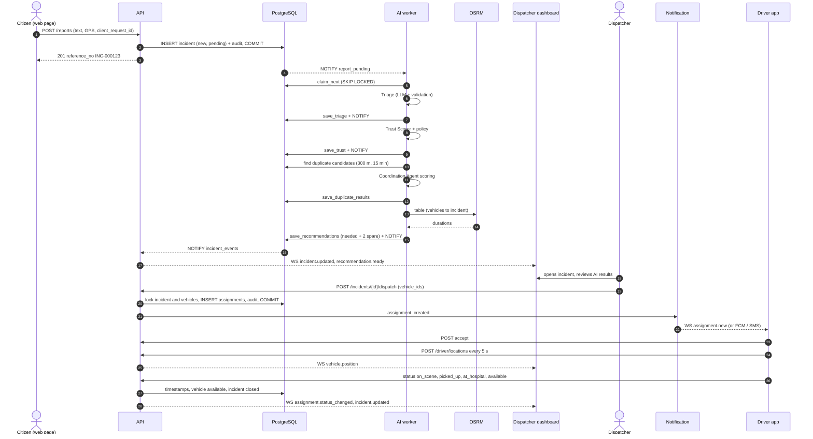

# Part 9 — Integration plan

How every module connects, in the order a real report travels. Interfaces are the shared contracts C-1…C-7 (`planning/DECISIONS_LOG.md` §3) and the integration points IP-1…IP-5 (`planning/IMPLEMENTATION_PLAN.md` §4.2).

## 9.1 Connection map

| Link | Protocol | Contract | Joined in |
|---|---|---|---|
| Browser / app → API | HTTPS REST (JSON), `/api/v1` | C-3, C-4 (OpenAPI) | B2-03 (IP-5) |
| Browser / app ↔ API | WebSocket `wss://…/api/v1/ws` | C-5 envelope `{event, v, occurred_at, data}` | B2-02 (IP-2) |
| API → database | SQLAlchemy async | models + Alembic | B1 |
| Worker ↔ database | `pipeline_store` | C-6 | B2-01 (IP-1) |
| Worker → API (events) | Postgres `NOTIFY incident_events` → API `LISTEN` | C-5 | B2-02 |
| API → worker (jobs) | `incidents.pipeline_state` + `NOTIFY report_pending` | C-6 | B2-01 |
| Worker/API → OSRM | HTTP, private network | route + table | B1-A2-10, B3-03 (IP-4) |
| Worker → LLM | Gateway (HTTP) | `LLMClient` | B1-A2-02 |
| Worker → Nominatim | HTTP, ≤ 1 req/s | geocoder | B1-A2-05 |
| API → driver | WebSocket (primary), FCM, SMS | C-7 | B3-01 |
| Driver app → API | REST batches | `/driver/*` | B3-03 |
| Simulators → API | webhook + shared secret | `/intake/*` | B4-01/02 |

## 9.2 End-to-end example (illustrative, simulated data)

> **Scenario:** a citizen reports a road accident with several injured people. Names, places and numbers below are **made up** to show the flow; times are targets from the SRS, not measurements.

### Step by step (what is written where)

| # | What happens | Database change | Event / push | Target (SRS) |
|---|---|---|---|---|
| 1 | Citizen writes "bus and car crashed near the market chowk, about 6 people hurt", allows GPS, taps Send. The page shows the 1122 notice throughout | — | — | NFR-S7 |
| 2 | API validates, upserts caller, inserts incident (`channel=web`, `status=new`, `pipeline_state=pending`, `location_source=gps`, `caller_gps`, `settings_snapshot`), writes audit `report.received`, **commits**, returns `INC-000123` | `callers`, `incidents`, `audit_logs` | WS `incident.created` | NFR-P12; no AI yet |
| 3 | Worker claims the record immediately (NOTIFY) | `pipeline_state=processing` | — | — |
| 4 | Geocoder matches "market chowk" in the gazetteer (alias) → point; distance to caller GPS 120 m | `location`, `location_text` | — | UC-01 3 |
| 5 | **Triage Agent:** type `accident`, severity `high`, victims ≈ 6, confidence 0.88; flags: real details yes, vague no | `incident_type`, `severity`, `victims_estimate`, `confidence`, `ai_details`, `status` → `triaged` (no review reason); audit `ai.triage` | `incident.updated` | NFR-P1 ≤ 10 s |
| 6 | **Trust Scorer:** start 50; GPS within 500 m +15; real details +10 → **75, tier high**; policy: continue | `trust_score=75`, `trust_tier=high`, `trust_signals`; audit `ai.trust` | `incident.updated` | UC-03 |
| 7 | **Coordination Agent:** no open accident within 300 m / 15 min → no candidates | none (or `duplicate_candidates` rows if any) | — | UC-04 |
| 8 | **Resource Allocation Agent:** 6 victims → ⌈6÷2⌉ = 3 ambulances; OSRM `table` ranks free ambulances; list = 3 + 2 spare | `recommendations` (batch 1, current), `allocation_summary`; audit `ai.allocation` | `recommendation.ready` | NFR-P3 ≤ 5 s |
| 9 | Dispatcher sees the card in the queue (high), opens it: original text, AI fields with confidence, trust tier, map with route preview | — | — | UC-06 1 |
| 10 | Dispatcher keeps the three recommended ambulances, picks hospital, presses **Approve Dispatch** then **Confirm** (click 3) | one transaction: `assignments` ×3 (`approved_by`), vehicles → `assigned`, incident → `dispatched`; audit `dispatch.approved` with `{recommended, selected}` | `dispatch.approved`; driver `assignment.new` | NFR-S1, NFR-S6, NFR-P14 |
| 11 | Driver app shows red banner + sound; driver taps **Accept** | assignment `accepted`, vehicle `en_route` | `assignment.accepted` | NFR-P5 ≤ 5 s |
| 12 | Navigation opens, route from OSRM; app sends GPS every ~5 s | `vehicle_locations`, `vehicles.last_location/last_seen_at` | `vehicle.position` | NFR-P4 ≤ 5 s |
| 13 | Within 100 m of the scene the app sets **On scene** automatically | `on_scene_at`, vehicle `on_scene`, incident `on_scene` | `assignment.status_changed` | UC-09 |
| 14 | Driver taps **Patient picked up** (navigation to hospital), arrives → **At hospital** automatic, taps **Available** | `picked_up_at`, `at_hospital_at`, `completed_at`; vehicle `available` | events | UC-09 |
| 15 | Last assignment completed → incident **closed**; reports page can now show the timeline received → triaged → approved → arrived | `incidents.status=closed`, `closed_at` | `incident.updated` | UC-13 |

## 9.3 Variants to test end to end

| Variant | What changes | Test |
|---|---|---|
| Duplicate report 100 m away, 5 min later | Coordination auto-links both (≥ 85); both stay dispatchable; UI shows "multiple reports" | TC-13 |
| Caller with two earlier fake reports, low severity | Trust low → review queue; no allocation until dispatcher marks Real | TC-09, TC-25 |
| Same caller, **critical** severity | `urgent_with_warning`; allocation runs; dispatcher can dispatch while checking | TC-10 |
| Worker stopped | Report still saved, `pending`; dashboard shows AI-down banner; manual dispatch works | TC-44, TC-45 |
| OSRM stopped | ETA shown with "approximate" tag | TC-20 |
| Two dispatchers pick the same vehicle | Second gets 409 + next best | TC-22 |
| Driver taps Cannot Go | Vehicle freed, `reallocate`, new recommendations | TC-27 |
| Driver silent 60 s | `timed_out`, dispatcher alerted | TC-28 |
| GPS stops 60 s | Vehicle grey "signal lost" + alert | TC-31 |

## 9.4 Error and recovery workflows

| Situation | What the system does | What the person sees |
|---|---|---|
| Database unavailable at intake | 503, **no reference number** | "Could not save your report — call 1122" |
| Worker dies mid-job | stale `processing` reset to `pending`, stages already saved are kept | Short delay; no loss |
| LLM unavailable | `mark_stage_failed`, incident `needs_check` + `ai_failed` | Banner "AI unavailable — manual mode" |
| WebSocket drops | Client reconnects with back-off and refetches via REST | Connection indicator, then up to date |
| Driver phone offline at approval | Dispatcher warned, SMS (simulated) backup; points buffered when the driver is back | "Driver app not reachable" |
| Network drop in the vehicle | App buffers GPS; sends batch later; server keeps newest position | Map shows grey after 60 s, then catches up |
| Two writes race for a vehicle | DB partial unique index → IntegrityError → 409 | Warning + next best |
| Dispatcher edits an incident during processing | Edit saved, recommendations of the old batch marked not current, `reallocate` queued | "Recalculating…" then new list |

## 9.5 Integration order (matches the batches)

1. B2-01 Worker ↔ real database (replace the fake store). 2. B2-02 events to the dashboard. 3. B2-03 frontend off mocks for intake → review. 4. B2-04 re-allocation round trip. 5. B2-05/06 trust, duplicate and AI-failure scenarios. 6. B3-01…06 approval → driver → tracking → completion. 7. B4 simulators and scenarios. 8. B5 admin and reports. Details: `planning/IMPLEMENTATION_PLAN.md` Batches 2–5.
