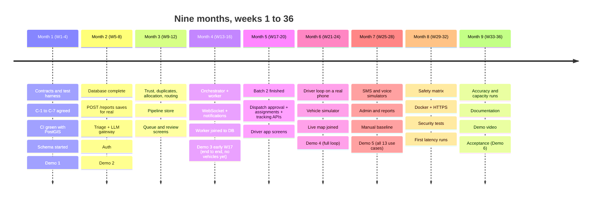
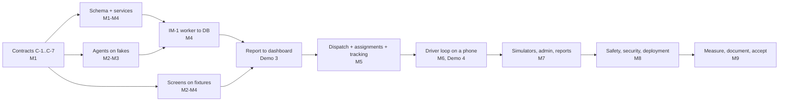

# Part 11 — Nine-month roadmap and team responsibilities

**Status:** proposal for approval. **Calendar dates are not in the SRS/SDS**, so the plan uses **weeks 1–36** (D-032: the team fixes the start date, the pilot area and the supervisor/viva dates). The schedule uses the task IDs of `planning/IMPLEMENTATION_PLAN.md` v0.2 (`A1-03` = `B1-A1-03`, `A2-xx`, `A3-xx`; `B2-01`…`B9-09` are batch tasks). It was checked by script against the dependencies in the plan; the two ordering conflicts it found are listed in §11.7.

## 11.1 Shape of the nine months

## 11.2 Monthly milestones

| Month | Milestone (what must be true at the end) | Deliverables | Test milestone | Integration milestone | Supervisor demo |
|---|---|---|---|---|---|
| **1** W1–4 | Contracts C-1…C-7 v1 signed off by all three; repository clean; tests run in Docker and CI; first migrations | `docs/API_CONTRACT.md`, `schemas/{enums,incident,ai,auth,events,assignment}.py`, OpenAPI with 501 stubs, `docker compose run api pytest` green, Vite apps build | First **verified** test results (replaces "BLOCKED") | — | **Demo 1:** blueprint, CI green, contracts, OpenAPI surface |
| **2** W5–8 | Whole schema migrated; real `POST /reports`; Triage Agent passes FakeLLM tests; first real LLM latency numbers; login works | models + `0002_initial_schema`, settings + audit services, intake service, TriageAgent + Gateway, geocoder + gazetteer, auth API, public report page (mock → real) | TC-01, 03, 04, 50 pass; DB constraint tests | Public page ↔ real API | **Demo 2:** submit a report on the web page → saved record + reference number visible in the database/API (no AI yet) |
| **3** W9–12 | Trust Scorer, policy, similarity, Coordination, routing, Allocation agents pass unit tests; pipeline store passes concurrency tests; OSRM runs | `agents/*`, `integrations/routing.py`, `pipeline_store`, OSRM container data, seed data, queue + review screens (fixtures) | Agent unit suites; claim concurrency; TC-06–09, 11, 13, 14, 16–19 at unit level | — | — |
| **4** W13–16 | Orchestrator and worker run on the real database; events reach the dashboard; first end-to-end report | orchestrator v1 (text path), worker, WebSocket hub + NOTIFY, notification service, queue/detail/edit/duplicate/review APIs, live screens | Integration tests with real `pipeline_store` | **IM-1:** worker ↔ DB (B2-01), events → dashboard (B2-02) | **Demo 3 (early week 17):** a typed report appears on the dashboard triaged, trust-checked, duplicate-checked, with vehicle recommendations |
| **5** W17–20 | Batch 2 closed; dispatch approval locks vehicles; assignments, GPS ingestion and scheduler work in API tests; driver app screens exist | `dispatch`, `assignments`, `tracking`, `scheduler` services, mobile app scaffold + duty + assignment alert, A2-17 evaluation harness first report (text metrics) | TC-21, 22 (50-run concurrency), 23–29 at API level, TC-09–15 e2e, TC-44 | **IM-2:** frontend off mocks (B2-03), reallocation round trip (B2-04) | — |
| **6** W21–24 | Full loop on a real Android phone with simulated movement | navigation, trip status, live map on live data, citizen mode, hospital suggestion, STT node, vehicle simulator (100 vehicles), SMS backup | TC-26–31, 41, 42 on device; first NFR-P4/P5 timings | **IM-3:** approve → driver → GPS → map → close (Batch 3) | **Demo 4:** dispatcher approves, driver phone alerts, vehicle moves on the map, trip completes |
| **7** W25–28 | All 13 use cases demonstrable; admin and reports done; channels simulated; manual baseline measured | admin panel + APIs, reports + export, SMS/voice simulators, STT end to end, test suites, scenario library | TC-02, 12, 34–37, 48; audit completeness script; tuning on the development split | **IM-4:** SMS/voice → dashboard; admin settings change affects only new incidents | **Demo 5 (progress evaluation):** every use case UC-01…13 shown |
| **8** W29–32 | Safety rules proved; whole system starts with Docker over HTTPS; security tests pass | safety matrix, full compose (api, ai-worker, postgres, osrm, nginx, web), TLS, secrets, backups, install guide | TC-44–46, 49, 50, 05, 48; first TC-38–40 runs; TC-51, 52 | **IM-5:** clean-machine install | — |
| **9** W33–36 | Targets measured and reported; documentation complete; acceptance passed | `docs/test-reports/*`, user guides, API description, demo script + video, SDS/SRS change note | TC-38–43, AI accuracy (P7–P10), uptime (P11) | final regression | **Demo 6:** supervisor acceptance session (SDS §8.1) |

## 11.3 Weekly plan

`*` after a task = continues from the previous week. Weeks with several items are short tasks. `A2-16` (evaluation data) is background labelling work spread over weeks 5–12.

| Wk | Arjun (AI + backend core) | Khalid (frontend + mobile) | Sumeet (database, data, tests, deployment) |
|---|---|---|---|
| 1 | A1-03 | A3-01 | A1-01, A1-02 |
| 2 | A2-01 | A3-01*, Android spike: React Native + GPS on a real phone | A1-02*, A1-06 |
| 3 | A1-04 | A3-01*, Spike result → decide Expo vs bare (D-002) | A1-07 |
| 4 | A1-05 | A3-02, A3-05 | A1-08, A1-09 |
| 5 | A2-02 | A3-04, A3-05* | A1-10, A2-16 |
| 6 | A2-03 | A3-03 | A1-11, A2-16* |
| 7 | A2-05 | A3-03* | A1-12, A1-13, A2-16* |
| 8 | A1-16 | A3-06 | A1-14, A2-16* |
| 9 | A2-06, A2-07 | A3-07 | A1-15, A1-34, A2-16* |
| 10 | A2-08, A2-09 | A3-07* | A1-17, A1-18, A2-16*, OSRM extract + data prep (data side of A2-10) |
| 11 | A2-10 | A3-09 | A1-19, A2-16*, OSRM data prep, container |
| 12 | A1-29, A2-11 | A3-08 | A1-19*, A2-16* |
| 13 | A1-30, A2-13 | A3-08* | A1-20 |
| 14 | A1-25, A2-14 | A3-10 | A1-21, A1-22 |
| 15 | A1-25*, A2-15 | — | A1-23 |
| 16 | B2-01, B2-02 | B2-03 | A1-24, B2-01 (join worker to real DB) |
| 17 | B2-04, B2-05 | A3-13, B2-03 | A1-26, Batch 2 test report |
| 18 | A2-17, B2-06 | A3-13*, A3-15 | A1-27 |
| 19 | B3-01 | A3-15*, A3-16, B3-01 UI side | A1-28 |
| 20 | B3-02 (lead) | A3-16*, A3-17, B3-02 UI side | A1-31, B3-02 |
| 21 | B3-03 | A3-17*, A3-18, B3-03 on device | A1-32, B4-03 vehicle simulator |
| 22 | B3-04 | A3-18*, B3-04 on device | A1-33, B4-03 |
| 23 | B3-05, B3-06 | A3-10 joined to live data, B3-05 on device | B4-03; run TC-29/30/31 |
| 24 | A2-04, A2-12 | A3-14 | B4-05 scenarios, Batch 3 test report |
| 25 | B4-01, B4-02 | A3-11 | B5-04 audit completeness |
| 26 | Threshold tuning (D-033, STT) | A3-12 | B5-01, B5-02 |
| 27 | B8-06/07 tuning run on the tuning split | A3-19, B4-04 (P2) | B5-03 prepare |
| 28 | B5-03 | B5-03, B9 screenshots start | B5-03 |
| 29 | B6-04, B6-05 | B6 UI checks | B6-01, B6-02, B6-03, B8-12 uptime logging starts |
| 30 | B6-07 | B6-06 UI | B6-06, B7-01 |
| 31 | B7-04 | B7-02 Android CA | B7-02, B7-03 |
| 32 | B8-01, B8-02, B8-03 | B8-10 | B7-05, B7-06, B7-07 |
| 33 | B8-06, B8-07, B8-08 | B9-01, B9-02 | B8-04, B8-05 |
| 34 | B8-09, B8-11, fixes | B9-03, B9-04 | B9-05, B8-12 report |
| 35 | B9-06 (AI part), fixes | B9-07 | B9-06 |
| 36 | B9-08, B9-09 | B9-08, B9-09 | B9-08, B9-09 |

## 11.4 Responsibilities (proposal D-034, extends D-027b)

Team roles are fixed by the team slide (A-007). The **task-level** split is not approved yet. D-027b proposed Arjun 36 / Khalid 19 / Sumeet 15 of the 70 Batch-1 tasks, which overloads Arjun. This roadmap uses the following rebalance (D-034):

| Person | Role (slide) | Batch-1 tasks in this roadmap | Count |
|---|---|---|---|
| **Arjun Kumar** | AI & backend development | All AI: A2-01…15, 17. Contracts and safety-critical services: A1-03, 04, 05, 16 (intake), 25 (dispatch approval), 29 (WebSocket), 30 (notifications) | 23 |
| **Khalid Hussain** | Frontend & UI/UX | A3-01…19 (web, dashboard, public page, **and the Android app** — assumption to confirm) | 19 |
| **Sumeet Kumar** | Database & technical support (datasets, testing, documentation, deployment) | Database and persistence: A1-01, 02, 06–13, 19, 34; services moved from D-027b's Arjun list: A1-14, 15, 17, 18, 20–24, 26–28, 33; admin/analytics: A1-31, 32; data: A2-16 | 28 |

Sumeet's 28 are mostly short service/CRUD tasks with clear tests; Arjun's 23 hold all AI work and the hardest safety logic. The team can still move tasks between people — the dependency check in §11.6 must be re-run after any move.

**Shared work (everyone):** contract reviews in Month 1, integration milestones IM-1…IM-5, scenario runs, regression before each demo, the safety matrix, documentation. **Review rule:** each person's pull request is reviewed by one of the other two; the dispatch service (A1-25) and the pipeline store (A1-19) are reviewed by all three.

| Area | Lead | Backup |
|---|---|---|
| Agents, LLM, STT, routing | Arjun | Sumeet |
| API, services, database | Sumeet (database), Arjun (contracts, intake, dispatch) | each other |
| Dashboard and public page | Khalid | Arjun |
| Android app | Khalid | Arjun |
| Simulators, datasets, test reports, deployment, user guides | Sumeet | Khalid (screens, text), Arjun (AI parts) |

## 11.5 Module dependencies that shape the order

## 11.6 Why this order is safe

1. **Contracts first** (Month 1) so three people can work in parallel without guessing formats.
2. **Save-first intake before any AI** (Month 2): the safety property exists before the intelligent parts do.
3. **Agents on fakes** (Months 2–3): each agent is tested alone before integration (your prompt's rule); no agent waits for the database.
4. **Dispatcher functionality before advanced mobile integration**; **GPS and real time after the core workflow works** — as your prompt requires. Mobile screens are built from Month 5 against fixtures and joined in Month 6.
5. **Testing and deployment throughout:** CI from week 2; full Docker stack grows from week 16 (`ai-worker`, `osrm`), TLS in Month 8.
6. Mechanical check: `python docs/blueprint/tools/schedule_check.py` — every Batch-1 task starts after its dependencies end (same-owner tasks may start in the week the dependency ends). Result when written: **0 violations** after the fixes in §11.7; peak 2 concurrent tasks for Arjun and Khalid, 3 for Sumeet in weeks 7, 9, 10 (the third is the background data-labelling task A2-16). The script holds the schedule data, so re-run it after any task is moved.

## 11.7 Plan clarifications found while scheduling (need approval as plan changes)

| # | Finding | Handling |
|---|---|---|
| P-1 | `B1-A2-13` (orchestrator) lists `A2-04` (STT) and `A2-12` (hospital) as prerequisites, but the first end-to-end demo is text only | Deliver the orchestrator in two steps: v1 (text path) in week 13; add the STT and hospital nodes in week 24 |
| P-2 | `B1-A2-17` (evaluation harness) lists `A2-04` as a prerequisite, but type/severity accuracy needs no speech | Deliver harness v1 (text metrics) in week 18; add word-error-rate when STT lands (week 24–25) |
| P-3 | `B1-A1-24` (confirmation requests) needs `A1-30` (notifications), which needs `A1-29` (WebSocket) | Order: A1-29 (wk 12) → A1-30 (wk 13) → A1-24 (wk 16); TC-12 end-to-end therefore waits for week 16–17 |

## 11.8 Slack and the scope-cut ladder

The schedule has **about one week of real slack** (week 36) and some light weeks for Arjun in weeks 19–23 that should absorb Batch 2 fixes and prompt tuning. If a month ends more than one week late, cut in this order (all are P1/P2 or have a stated fallback; **no safety rule is ever cut**):

1. PDF export (CSV stays) — B1-A1-32 P2.
2. Channel-simulator dashboard page — B4-04 P2 (use the command-line simulators).
3. FCM push — keep WebSocket primary + SMS backup (D-013).
4. Hospital-suggestion refinement — nearest active hospital only (B1-A2-12).
5. Citizen **mobile** mode — the public web page already covers UC-01 (B1-A3-14).
6. Sindhi voice accuracy targets — report honestly, text channel is the backup.
7. Local LLM — use the hosted provider if the machine cannot run both (D-008).

Never cut: save-first intake, dispatcher approval, one-open-assignment guard, urgent-never-waits, manual mode, audit log, the 1122 notice.

## 11.9 Decisions needed by a date

| By | Decision |
|---|---|
| Week 1 | D-001 (delete duplicate tree), D-001b (commit v1.1 SRS/SDS), D-027b/D-034 (who does what), D-032 (start date, pilot area, viva dates), D-031 (schema mapping) |
| Week 3 | D-002 sub-choice (Expo vs bare) after the Android spike; D-015 (web tooling) |
| Week 4 | D-023 (sessions), D-009 (geocoding), D-019 and the vehicle-rule extensions, D-035 |
| Week 8 | D-014 (SMS/voice simulator), D-022 (flood thresholds), D-029 (scheduler), D-013 (FCM owner) |
| Week 9 | D-007/D-033 (duplicate formula, similarity dependency), D-021, D-018 |
| Week 18 | D-016 (navigation approach), D-028 (tiles) before the driver app work |
| Week 28 | D-024 (TLS plan), D-025 (manual baseline) before Month 8 |
| Week 34 | D-008 (final LLM) with the evaluation numbers; D-017 (targets confirmed by supervisor) |
